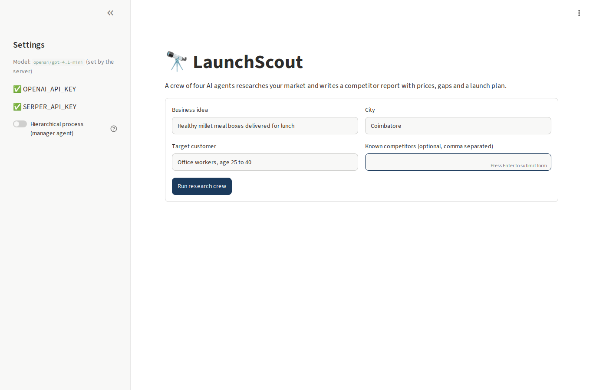
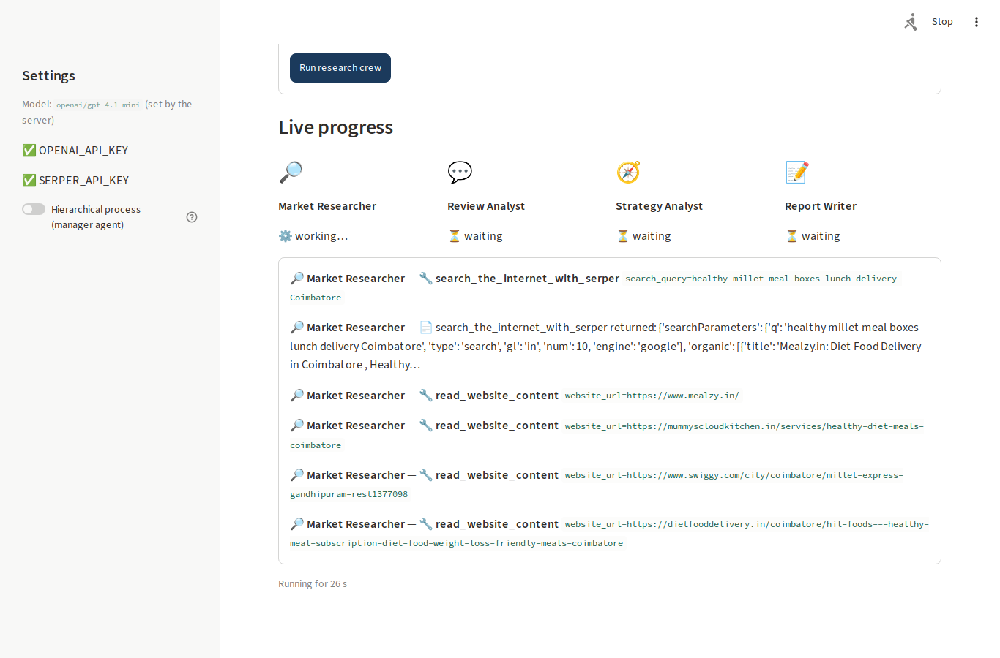
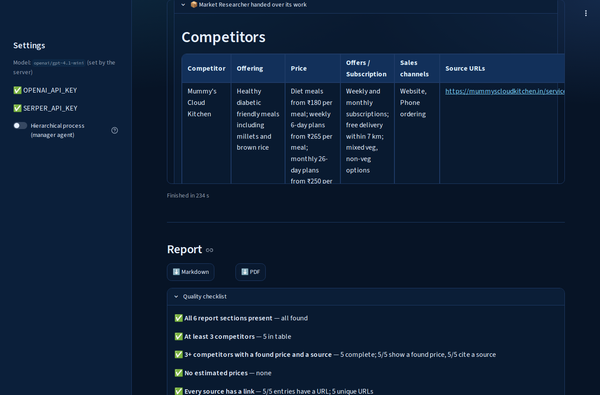
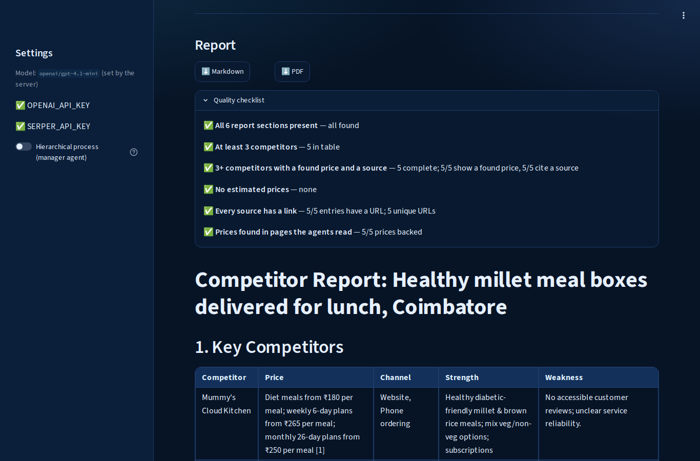
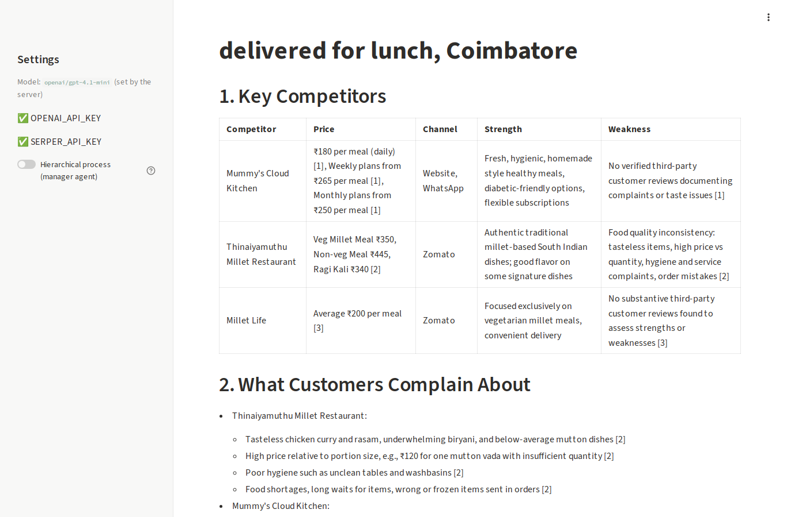
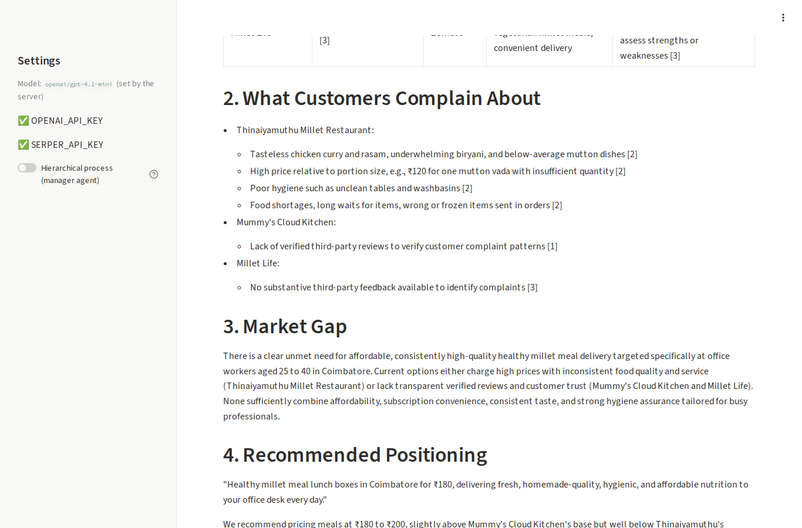
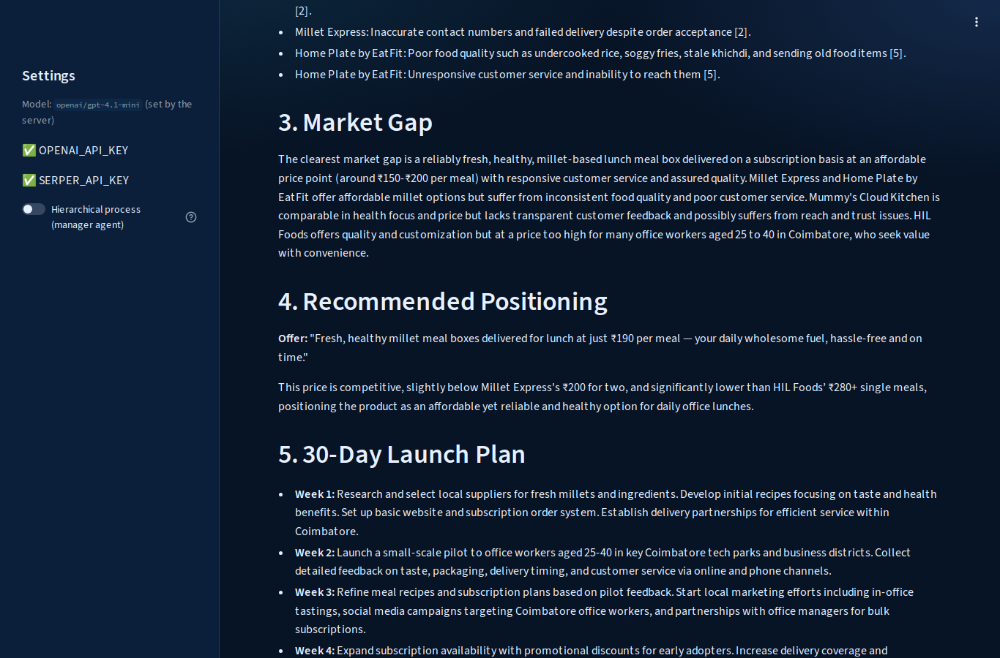
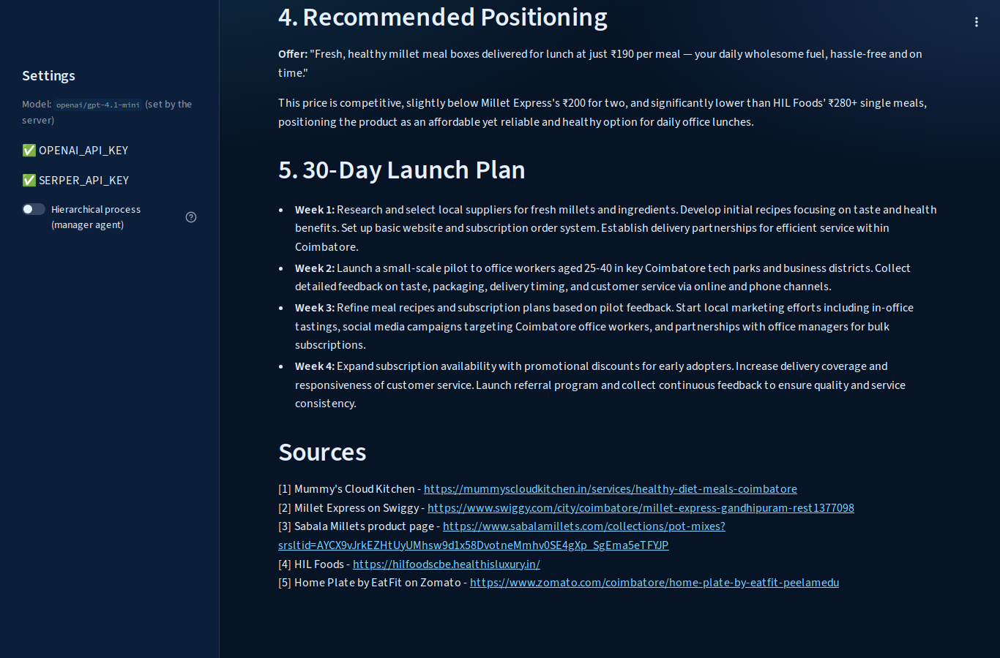

# LaunchScout: Competitor Research Crew

🌐 **Live app:** https://www.kowsalyagroups.com/techstack/launchscout/

Four CrewAI agents research the market for a business idea and deliver a sourced
competitor report with prices, customer complaints, the market gap, a recommended
positioning and a 30-day launch plan.

| Agent | Goal | Tools |
|---|---|---|
| Market Researcher | 3 to 5 real competitors with prices, offers, channels, source URLs | Serper search, website scraper |
| Review Analyst | What customers like / complain about, per competitor, with sources | Serper search, website scraper, Google Maps reviews (Serper) |
| Strategy Analyst | Comparison matrix, market gap, price and positioning | none (reasons on prior work) |
| Report Writer | Founder-friendly 6-section report saved as `output/report.md` | File writer |

Tasks run with `Process.sequential`; each task gets the earlier tasks as `context`.
A sidebar toggle switches to `Process.hierarchical` with a manager LLM (stretch goal).

## Screenshots: each output requirement

Captured from the live app with the sample input (healthy millet meal boxes, Coimbatore,
office workers 25 to 40) by [`scripts/take_screenshots.py`](scripts/take_screenshots.py).
The report from that run is in [`docs/sample/report.md`](docs/sample/report.md) and
[`docs/sample/report.pdf`](docs/sample/report.pdf).
To show it works for any idea and city with no code change, the live app also produced
[`docs/sample/bengaluru-pet-grooming-report.md`](docs/sample/bengaluru-pet-grooming-report.md)
(at-home pet grooming, Bengaluru: 5 competitors, all prices verified, 9 Google Maps reviews cited).

| Requirement | Screenshot |
|---|---|
| Input form: business idea, city, target customer, optional known competitors |  |
| Live progress: which agent is working and what it found (Market Researcher searching and reading pages) |  |
| Live progress: next agent working after the hand-off (Review Analyst) |  |
| Sequential tasks: each agent hands its output to the next as context |  |
| Final report shown in the app, Markdown/PDF download, quality checklist |  |
| 1. Key Competitors: price, channel, strength, weakness, with sources (Market Researcher) |  |
| 2. What Customers Complain About, with sources (Review Analyst) |  |
| 3. Market Gap and 4. Recommended Positioning (Strategy Analyst) |  |
| 5. 30-Day Launch Plan (Report Writer) |  |
| Sources: every price and claim links back to its page |  |

## Setup (Windows PowerShell)

Use Python 3.10 to 3.13 (CrewAI's dependencies have no prebuilt wheels for 3.14 yet).

```powershell
py -3.11 -m venv .venv
.venv\Scripts\Activate.ps1
pip install -r requirements.txt
copy .env.example .env   # then add your model key (OPENAI_API_KEY or ANTHROPIC_API_KEY)
streamlit run app.py
```

CLI run with the sample input: `python crew.py`.

The included `.env` uses `openai/gpt-4.1-mini` with the OpenAI key copied from the
reviewlens project. `SERPER_API_KEY` is optional: without it the crew searches with
DuckDuckGo (`ddgs`); with it, it uses Google via Serper and the Review Analyst also
gets real Google Maps reviews (lowest-rated first) with a link to each review.

Create the venv in a folder with a short path: Windows' 260-character path limit breaks
`pip` inside very deep folders.

## Files

- `crew.py`: agents, tasks, crew (all inputs are `{placeholders}`, so any idea/city works)
- `tools.py`: uses `crewai_tools` (SerperDevTool, ScrapeWebsiteTool, FileWriterTool); if that
  package cannot load (for example Windows Application Control blocking grpc's DLL), small
  drop-in versions with the same names are used
- `app.py`: Streamlit form, live per-agent status and step log, report view,
  Markdown/PDF download, automatic quality checklist
- `report_utils.py`: Markdown to PDF, checklist checks (6 sections, at least 3 competitors,
  price and source on every row, source links)
- `output/report.md`: latest report; `output/report_task_output.md`: the writer task's raw `output_file`;
  `output/price_check.json`: which prices were found in pages read; `output/runs/`: dated copy of every run

## Done checklist mapping

- Four agents with distinct role/goal/backstory: `crew.py`
- Every task has a format-specific `expected_output`: `crew.py`
- 3+ competitors with price and source: enforced in the task, verified in the app checklist
- 6 sections saved to a file: `output_file` on the writer task plus the file writer tool
- Shows which agent is working: four status cards plus a live step log
- Works for any idea/city without code changes: everything is driven by form inputs

## Run with Docker (local)

```powershell
copy .env.example .env   # add OPENAI_API_KEY (and optional SERPER_API_KEY)
docker compose up -d --build
```

Open http://localhost:8510. Reports are kept in the `output` Docker volume.

## Deploy on the Hostinger VPS (next to ReviewLens)

The live app shares the VPS and the Caddy HTTPS proxy of
[ReviewLens](https://github.com/prasanth-sundararajan/reviewlens), which owns ports 80/443.
LaunchScout joins ReviewLens' Docker network and is served under `/techstack/launchscout/`.

```bash
git clone https://github.com/prasanth-sundararajan/launchscout.git /opt/launchscout
cd /opt/launchscout && nano .env          # same keys as .env.example
docker compose -f docker-compose.yml -f docker-compose.prod.yml up -d --build
```

ReviewLens' Caddyfile imports route files from `/opt/reviewlens/sites.d/`. Install
LaunchScout's route from [`deploy/launchscout.caddy`](deploy/launchscout.caddy) and reload Caddy:

```bash
cp /opt/launchscout/deploy/launchscout.caddy /opt/reviewlens/sites.d/
docker exec reviewlens-caddy-1 caddy reload --config /etc/caddy/Caddyfile --adapter caddyfile
```

On this server ReviewLens itself is at `/techstack/ReviewLens/` (`APP_PATH=techstack/ReviewLens`
in ReviewLens' `.env`).

Update later with:

```bash
cd /opt/launchscout && git pull && docker compose -f docker-compose.yml -f docker-compose.prod.yml up -d --build
```
